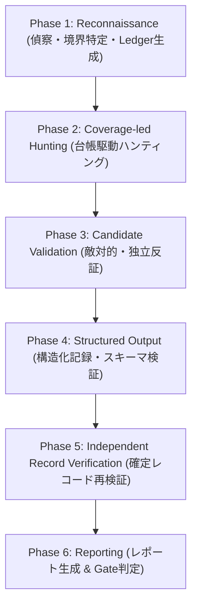

# ワークフロー: /security-audit

## 目的
本ワークフローは、Cloudflareの設計思想（`cloudflare/security-audit-skill`）に準拠し、客観的証跡に基づいた網羅的な脆弱性監査を遂行するための標準手順書です。
推測による誤検知を排し、独立検証（Adversarial Validation）と網羅性台帳（Coverage Ledger）による確実な監査を実施します。

正本規範: `ai-context/rules/security_audit_policy.md`  
出典: [Cloudflare Security Audit Skill](https://github.com/cloudflare/security-audit-skill) (MIT License)

---

## 監査プロファイルの選定 (Run Profiles)

監査開始時に、監査対象の規模・変更量・目的に応じてプロファイルを決定します。

| プロファイル | 適用場面 | 特徴と検証強度 |
| :--- | :--- | :--- |
| **`quick`** | 変更差分が小さい場合、小規模CLI/ライブラリ、再監査時の高速確認。 | 台帳ユニットを集約。1回のハンター波＋1回のカバレッジ批評＋1回の独立検証。後続波は起動せず未達分は `deferred`。 |
| **`standard`** | 通常の機能リリース前検査（デフォルト）。 | 標準6フェーズ。ハンター波とカバレッジ批評波を回し、候補検証と最終検証を独立した検証者が実施。 |
| **`deep`** | 決済・認証・機密データ処理を伴う重要機能、大規模リファクタリング後。 | サブシステム・ライフサイクル別に細分化。批評波が完全にクリーンになるまで反復。独立検証を多重化。 |
| **`scoped`** | `release/*` ブランチと `main` の git diff 対象ファイルに限定した監査。 | スコープ外パスを `out_of_scope` として記録し、変更境界・差分周辺に集中して監査。 |

---

## 監査の稼働手順 (Setup & Execution Steps)

### Step 0: 前提確認とスキルのインストール (Prerequisites & Installation)
監査実行前に、以下の環境前提とスキルのインストール状態を確認します。

1. **前提環境の確認:**
   - **Node.js:** バリデータスクリプト（`validate-coverage-ledger.cjs`, `validate-findings.cjs`）実行用（`node -v`）。
   - **OSサンドボックス制約:** 外部通信遮断・環境変数分離・書き込み制限が可能な環境であることを確認。
2. **Skillのインストール (Skills CLI):**
   - リポジトリ内またはユーザー環境にスキルが未導入の場合、以下のコマンドでインストールします。
     ```bash
     # グローバルインストール（推奨）
     npx skills add https://github.com/cloudflare/security-audit-skill --skill security-audit --global

     # またはプロジェクトローカル導入
     npx skills add https://github.com/cloudflare/security-audit-skill --skill security-audit
     ```

### Step 0.5: 稼働指示の策定 (Trigger Prompts & Output Directory)
1. **出力先ディレクトリの選定:**
   - デフォルト: `~/security-audit-skill/<repo-name>/run-<N>`（リポジトリ外）
   - リポジトリ内を指定する場合: `.security-audits/run-<N>`（`.gitignore` 必須）
2. **エージェントへの稼働トリガー構文:**
   フル監査モード（Full Audit Mode）を確実に発動させるため、公式Readme仕様に基づく以下のプロンプトでエージェントへ監査を指示します。
   ```text
   # 標準的なフル監査（Standard Profile）
   security audit this codebase, output to ~/security-audit-skill/<repo-name>/run-1

   # 差分スコープ監査（Scoped Profile）
   do a security review with profile: scoped, output to ~/security-audit-skill/<repo-name>/run-1

   # 特定ディレクトリの監査
   find security vulnerabilities in ./src, output to ~/security-audit-skill/<repo-name>/run-1
   ```

---

## 監査の6フェーズ (Audit Workflow)



### Phase 1: Reconnaissance (アーキテクチャ偵察と境界特定)
1. **信頼境界・入力面の特定:**
   - システムアーキテクチャ、認証境界、認可境界、外部通信面、ユーザー入力ポイントをマッピング。
   - 成果物として `architecture.md` を作成または更新。
2. **網羅性台帳（Coverage Ledger）の初期化:**
   - 監査対象の表面（Surface）× 境界（Boundary）× 攻撃分類（Attack Class）ごとに監査ユニットを策定。
   - 過去の監査台帳（`coverage-ledger.json`）が存在する場合は読み込み、変更差分を特定して `planned` ユニットへ引き継ぐ。

### Phase 2: Coverage-led Hunting (台帳駆動の脆弱性ハンティング)
1. **ユニット別ハンターの割り当て:**
   - Ledgerユニットごとに調査担当エージェント（Hunter）を割り当て、具体的な攻撃シナリオ（インジェクション、認可不備、SSR、認証迂回、状態不整合等）を探索。
2. **カバレッジ批評波（Coverage Critics）:**
   - 探索の網羅性を評価する批評役が、見落とされた入力面や境界ギャップを指摘し、追加ユニットを作成。

### Phase 3: Candidate Validation (敵対的・独立検証)
1. **発見者と検証者の分離:**
   - ハンターが提示した脆弱性候補（Candidate）は、**必ず別の独立した検証エージェント（Verifier）** へ引き渡す。
2. **反証（Disprove）の試行:**
   - 検証者は「その脆弱性が成立しない理由（上流のバリデーション、型制約、認証ガード等）」を積極的に探索・実証する。
   - 境界破綻が実証・反証不能であった場合のみ `confirmed` 候補とし、確証が得られない環境依存要素がある場合は `needs_validation` とする。

### Phase 4: Structured Output (構造化出力と記録)
1. **判定ステータスの確定:**
   - `confirmed`: ソースコード上の完全なトレース、影響リソース、深刻度（Severity: Critical / High / Medium / Low）を記録。
   - `needs_validation`: 未解決の具体的事実、ブロック要因、安全な検証計画を記録（Severityは空）。
   - `rejected`: 棄却理由、有効であった防御壁（Mitigating Control）を記録。
2. **構造化ファイルへの記録:**
   - `findings.json` および `coverage-ledger.json` を更新。

### Phase 5: Independent Record Verification (確定レコードの最終独立検証)
1. **ソースクレームの再確認:**
   - `confirmed` とされたレコードについて、最新のソースコード状態と照合し、記載されたファイルパス・行番号・ロジックに齟齬がないかを再確認。
2. **修正提案の最小化:**
   - 最小限かつ効果的な修正パッチ（Smallest Effective Fix）を提示。

### Phase 6: Reporting (対象中立レポートの生成)
1. **成果物レポートの出力:**
   - `REPORT.md`: 監査サマリー、プロファイル、スコープ、カバレッジ達成率、主要判定。
   - `FINDINGS-DETAIL.md`: `confirmed` の詳細、悪用シナリオ、影響度、修正指針。
   - `NEEDS-VALIDATION.md`: `needs_validation` の未解決項目とリリース判定への影響評価。

---

## リリースゲート判定基準 (Release Gate Criteria)

`release_gate` におけるセキュリティ監査の合否基準は以下の通りとします。

- **PASS:**
  - `confirmed` な脆弱性（Critical / High / Medium / Low）が **0件**。
  - `needs_validation` にリリースをブロックする重大リスクが含まれていない。
  - 監査スコープのカバレッジが計画通り完了している。
- **CONDITIONAL:**
  - `confirmed` な脆弱性に Low の軽微な指摘のみが存在し、リリース後直ちに対応計画（期日・担当者付き）が策定されている。
  - `needs_validation` の残課題が運用監視でカバー可能である。
- **FAIL:**
  - `confirmed` な脆弱性（Critical / High / Medium）が **1件以上存在** する。
  - `needs_validation` の中に、未検証のままリリースした場合に深刻な情報漏洩や不正操作につながる高リスク懸念が残存している。

